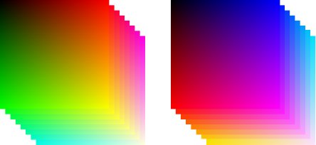

# xyz2zxy

Convert XY cross-sectional images into ZX cross-sectional images.



## Overview

-   This program converts 3D images represented by XY cross-sectional
    slices into ZX cross-sections.
-   A straightforward conversion would require loading all images into
    memory, which is impractical for very large datasets.
-   To address this, the program uses a **divide-and-conquer approach**
    (or optionally, temporary storage on HDD) to significantly reduce
    memory usage.
-   This is particularly useful for visualizing very large
    serial-sectioning images along different axis-aligned
    cross-sections.

## Release Notes

-   v2.0.0
    -   Added support for custom DPI in TIFF images.
    -   Added `xyz2yzx` (same arguments as `xyz2zxy`).
    -   Added support for multi-page TIFF input.

## Requirements

-   CMake (≥ 3.10)
-   C++17
-   OpenCV (≥ 4.5.0)
-   [fmt](https://fmt.dev) (≥ 8.0.1)

## Build and Test

### Unix-like systems with CMake

``` bash
mkdir build
cd build
cmake ..
make
```

### Validation

``` bash
./make_sample 
./xyz2zxy -i sample -o output -n 4
Step1 divide:[********************] (256/256)
Step2 concat:[********************] (256/256)
./validate output
validation ok
```

-   `make check` creates sample data and validates the results.

### Windows (Visual Studio)

-   Use CMake to generate the solution file.
-   Set `CMAKE_PREFIX_PATH` to the installation directories of OpenCV
    and fmt so that `find_package()` can locate them.

### Other systems

-   Not supported.

## Usage

    xyz2zxy -i {input_dir|mtif} -o {output_dir} ( -n {n} -p {px} {py} -e {ext} )
    xyz2yzx -i {input_dir|mtif} -o {output_dir} ( -n {n} -p {px} {py} -e {ext} )

-   **`{input_dir}`** : Directory containing the input images.
-   **`{mtif}`** : Multi-page TIFF file.
-   **`{output_dir}`** : Directory where converted images will be
    saved.
-   **`{n}`** : Number of images to load into memory at once (default:
    100). Larger values improve speed but require more memory.
-   **`{px} {py}`** : Pixel resolution \[mm\]. Available only for TIFF
    format.
-   **`{ext}`** : File extension of the input (e.g., `.tif`).

Additional executables for validation:
`make_sample`, `make_sample16`, `make_sample_mtif`, `validate`,
`validate_yzx`

## License

-   MIT License

## Author

-   Takashi Michikawa (<ram-axed-0b@icloud.com>), Image Processing
    Research Team, RIKEN Center for Advanced Photonics

## Copyright

-   Main code : © 2021--present RIKEN
-   `mi/*.hpp` : © 2007--present Takashi Michikawa

## Acknowlegments
* This work was supported by Council for Science, Technology and Innovation(CSTI), Cross-ministerial Strategic Innovation Promotion Program (SIP), “Materials Integration for revolutionary design system of structural materials”(Funding agency:JST).
